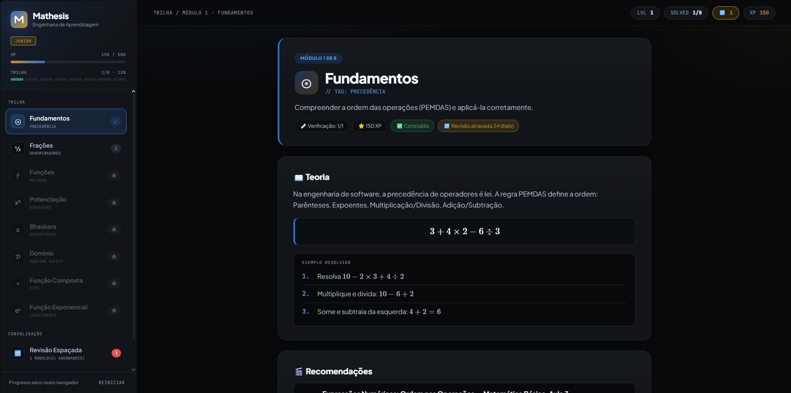

# Mathesis — Engenharia de Aprendizagem

> Trilha gamificada de matemática básica que trata o estudo como engenharia: pré-requisitos, verificação de domínio e revisão espaçada.



**[▶ Abrir a demo](https://Peseogo-stack.github.io/mathesis/)**

## Sobre

O Mathesis conduz o estudante por 8 módulos de matemática — da ordem das operações até a função exponencial — usando analogias de programação (precedência de operadores, funções como métodos, domínio como *runtime safety*, composição como *pipe*).

A trilha foi construída em torno de uma lista de 15 questões: as 8 primeiras são resolvidas dentro dos módulos, uma por módulo, e as 7 últimas formam um desafio final que exige vários conteúdos ao mesmo tempo.

## Funcionalidades

- **Trilha com pré-requisitos** — cada módulo só abre quando os módulos dos quais ele depende estão dominados.
- **Roteiro pedagógico em camadas** — teoria → exemplo resolvido → prática guiada → prática independente → verificação → revisão.
- **Verificação de domínio** — é preciso acertar 2/3 da verificação para concluir o módulo.
- **Revisão espaçada (sistema Leitner)** — módulos dominados entram numa fila com intervalos de 1, 3, 7, 16 e 35 dias. Acertou, o intervalo cresce; errou, volta para o começo. Inclui um simulador de tempo para testar o agendamento.
- **Desafio final integrador** — 7 questões que combinam dois ou mais módulos, com resolução passo a passo.
- **Gamificação** — XP, níveis, ranks (Junior → Principal), confete e mapa de domínio.
- **Curadoria de vídeos** — aulas recomendadas para cada módulo, com o momento ideal de assistir.
- **Progresso salvo no navegador** — via `localStorage`, sem servidor nem cadastro.
- **Responsivo e acessível** — funciona no celular, navegável por teclado e respeita `prefers-reduced-motion`.

## Tecnologias

- HTML, CSS e JavaScript puros — sem framework e sem etapa de build
- [MathJax 3](https://www.mathjax.org/) para renderizar as fórmulas escritas em LaTeX
- [canvas-confetti](https://github.com/catdad/canvas-confetti) para as comemorações

## Como rodar

Não é preciso instalar nada:

1. Clone o repositório:
   ```bash
   git clone https://github.com/Peseogo-stack/mathesis.git
   ```
2. Abra o arquivo `index.html` no navegador.

> As fontes, o MathJax e o confetti são carregados de CDN, então é preciso estar conectado à internet.

## Estrutura

```
mathesis/
├── index.html                  # estrutura da página
├── css/
│   └── styles.css              # visual: tema escuro, componentes e responsividade
├── js/
│   ├── data/
│   │   ├── modules.js          # conteúdo dos 8 módulos
│   │   └── final-challenge.js  # questões 9 a 15 (desafio final)
│   └── app.js                  # estado, regras, telas e eventos
└── docs/
    └── screenshot.png
```

O conteúdo fica separado da lógica: para criar ou editar questões, basta mexer nos arquivos de `js/data/`.

## Atalhos de teste

No console do navegador (F12 → Console):

| Comando | O que faz |
| --- | --- |
| `__mathesis.completeAll()` | conclui todos os módulos e libera o desafio final |
| `__mathesis.skipDays(7)` | avança o relógio 7 dias para testar a revisão espaçada |
| `__mathesis.reset()` | apaga todo o progresso salvo |

## Licença

Distribuído sob a licença MIT. Veja [LICENSE](LICENSE).
